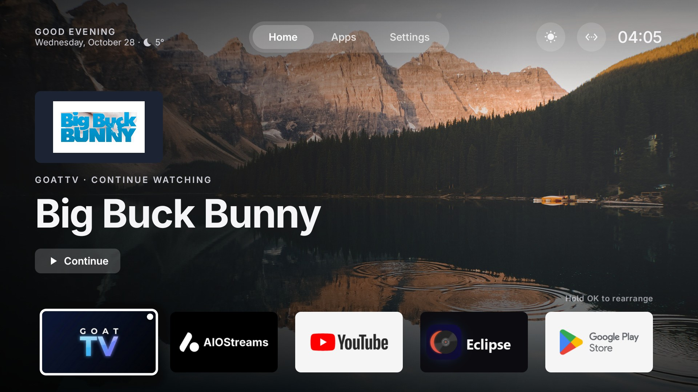
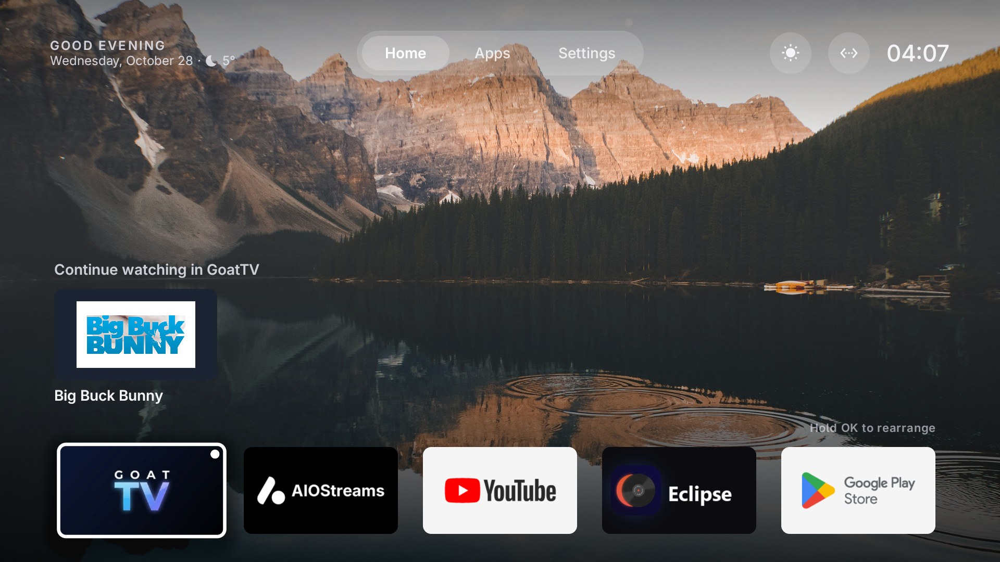
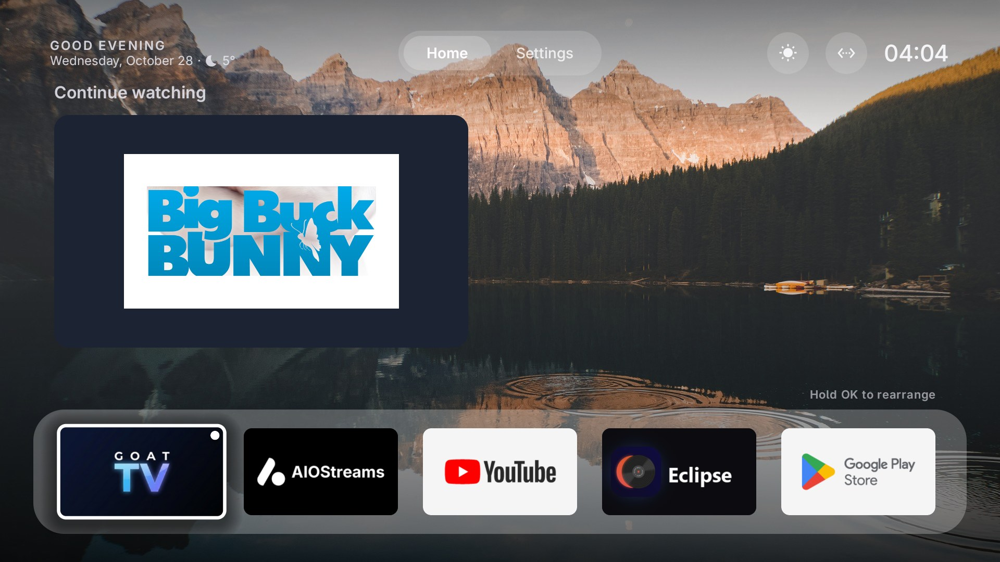
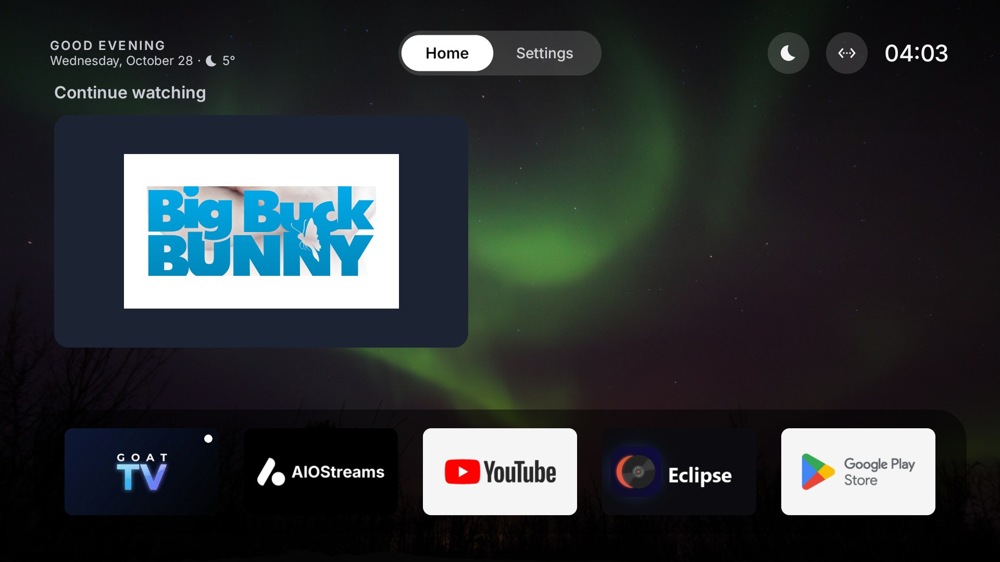
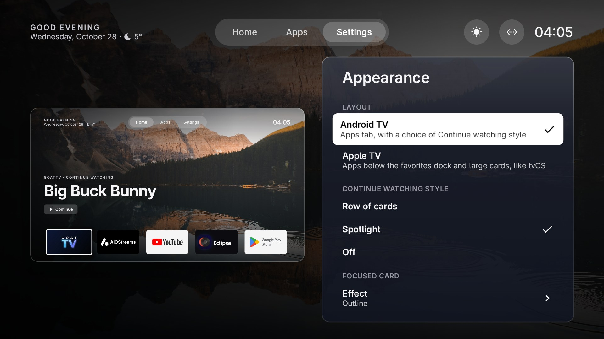
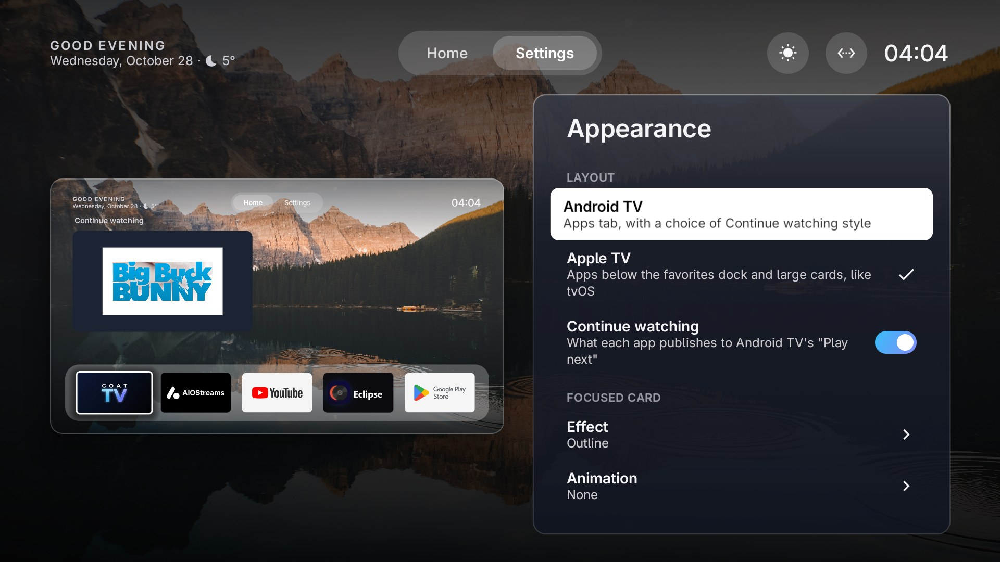
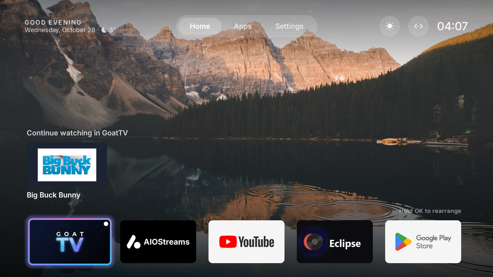

# GoatLauncher

A home screen for Android TV and Google TV.

## Screenshots

| | |
|---|---|
|  |  |
|  |  |
|  |  |
|  |  |

Wallpapers: CC0 photos from Wikimedia Commons. "Big Buck Bunny" © Blender Foundation, CC BY 3.0.

## Install

Latest version: https://github.com/GOAThings/GoatLauncher/releases/latest/download/goatlauncher.apk

On the TV, open the [Downloader](https://www.aftvnews.com/downloader/) app and enter the code **2462776**.

To make it the home screen, with adb:

```bash
adb shell cmd package set-home-activity cc.slokker.goatlauncher/.MainActivity
```

Once installed, the launcher finds new versions by itself (Settings → Updates).

## Features

- Favorite apps, the time and weather, and **Continue watching** from the apps on the TV (row of cards or
  spotlight), including YouTube with a linked Google account.
- Two layouts: Android TV style or tvOS style.
- Hide, rename, reorder and change the icon of any app.
- Wallpapers: built-in, your own images or a subreddit, darker at night.
- Focus effects and animations.
- Ambient mode and screensaver.
- Remote buttons that open the app you choose.
- Open an app when the TV turns on.
- Parental control.
- GOAT account sync.
- 15 languages.

## Build

Needs Android Studio (for the Android SDK and JDK).

```bash
./gradlew assembleDebug
```

Release builds are signed with a key that is not part of this repository.

## License

GoatLauncher is free software under the [GNU General Public License v3.0](LICENSE).

The license covers the code only. The names "GOAT" and "GoatLauncher" and their logos are not licensed: forks
must use their own name and artwork.

Third-party: [Adwaita Sans](third_party/adwaita-sans-OFL.txt) (SIL Open Font License 1.1).
