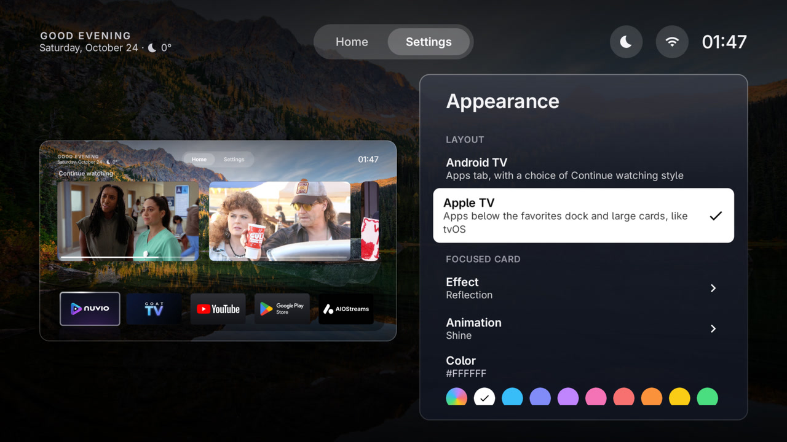

# GoatLauncher

A home screen for Android TV and Google TV, made for the NVIDIA SHIELD.

## Screenshots

| | |
|---|---|
|  |  |
|  |  |
|  |  |

## Install

Latest version: https://github.com/GOAThings/GoatLauncher/releases/latest/download/goatlauncher.apk

On the TV, open the [Downloader](https://www.aftvnews.com/downloader/) app and enter the code **2462776**.

To make it the home screen, with adb:

```bash
adb shell cmd package set-home-activity cc.slokker.goatlauncher/.MainActivity
```

To keep it there even when Android forgets it (for example after installing another launcher), turn on
**Keep as home screen** in Settings and allow it in Android's Accessibility settings. That also lets remote
buttons open apps.

Once installed, GoatLauncher finds new versions by itself (Settings → Updates).

## Features

- **Home**: favorite apps in a dock, the time, weather and a greeting, and **Continue watching** from the apps
  that publish to Android TV's "Play next" (as a row of cards or a large spotlight). With a linked Google
  account, YouTube videos in progress and recommendations show up there too.
- **Apps**: every TV app, with banners. Hide, rename, reorder, add to favorites, change the icon (icon packs
  or your own images).
- **Two layouts**: an Android TV style with an Apps tab, or a tvOS style with apps below the dock.
- **Wallpapers**: built-in ones, your own images (from the box, USB or network drives), or the top photos of a
  subreddit, changing every 30 minutes. Darker at night, automatically by sunset and sunrise.
- **Focus effects**: outline, glow, glass, reflection, aurora and more, with optional animations.
- **Ambient mode and screensaver**: the wallpaper with the time, weather and the channel playing, or a bouncing
  logo.
- **Remote buttons**: up to 5 buttons (the Netflix button, for example) can open the app you choose.
- **On power-on**: open an app when the TV turns on or wakes from standby.
- **Parental control**: a code to lock apps (always or at certain hours) and to protect the settings.
- **GOAT account**: keep the wallpaper and app order in your account, and link the TV with a code or QR.
- **Phone remote**: with [GoatRemote](https://github.com/GOAThings/GoatRemote) on an iPhone or Android phone,
  all the TV's apps show up on the phone with their banners, and the volume goes through GoatLauncher.
- 15 languages.

### Phone remotes on the SHIELD

On the SHIELD (Android 11), a volume key from a phone remote (GoatRemote or the Google TV app) can restart the
box while an accessibility service watches the remote's buttons, which GoatLauncher does when remote buttons
are set to open apps. This is a bug in Android itself. GoatLauncher 0.8.7 and newer avoid it with GoatRemote,
which then changes the volume through GoatLauncher, the same way the physical remote does.

## Build

Needs Android Studio (for the Android SDK and JDK).

```bash
./gradlew assembleDebug
```

Release builds are signed with a key that is not part of this repository.

### Code

- `MainActivity`, `ui/`: the launcher (home, apps, settings, linking a GOAT account).
- `HomeGuardService`: optional accessibility service that keeps GoatLauncher as the home screen, opens apps from
  remote buttons, enforces parental locks and opens apps at power-on (`AutoStart`). It only asks Android for key
  events when it needs them (`updateKeyFilter`).
- `AmbientDream`: the screensaver.
- `data/`: settings, installed apps, Continue watching (`WatchNext`), YouTube, weather, wallpapers, parental
  control, updates (`Updater`) and the GOAT account (`api/`).
- `data/PhoneApps`: a small HTTP server on port 6470, private addresses only, for GoatRemote: `GET /apps`,
  `GET /icon/<package>` and `POST /volume/up|down|mute`.

## License

GoatLauncher is free software under the [GNU General Public License v3.0](LICENSE).

The license covers the code only. The names "GOAT" and "GoatLauncher" and their logos are not licensed: forks
must use their own name and artwork.

Third-party: [Adwaita Sans](third_party/adwaita-sans-OFL.txt) (SIL Open Font License 1.1).
